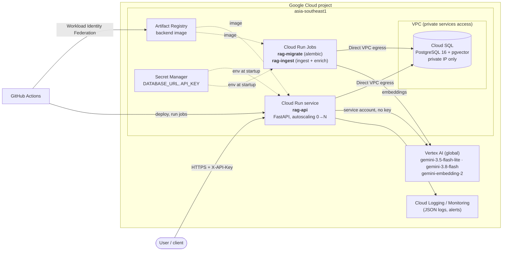
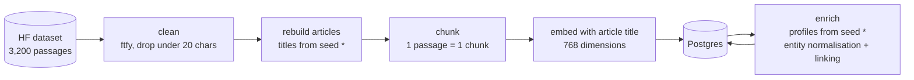
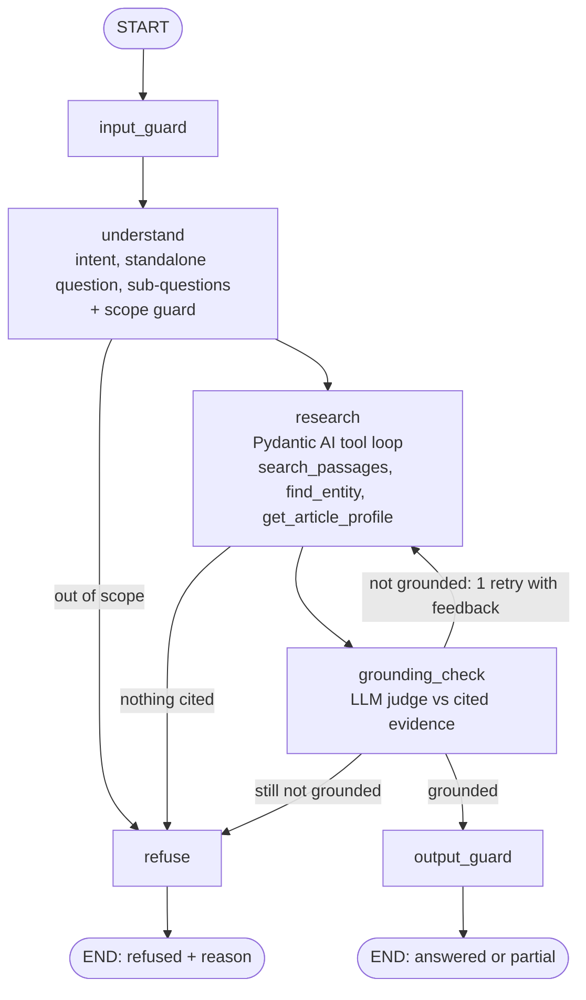

# Architecture

This document covers the proposed **Google Cloud deployment** and the **application** inside it.

> **Status**
> - **Built and measured:** the application (`/ask`, `/agent/ask`, ingestion, semantic layer), running locally in Docker against Vertex AI. All numbers below come from it.
> - **Proposed (target):** the GCP deployment in section 1. The API image, migrations and data jobs are already containerised for it.

---

## 1. Deployment on Google Cloud



### Services and why each one

| Service | Role | Why this choice |
|---|---|---|
| **Cloud Run** (service `rag-api`) | Runs the FastAPI container | Stateless HTTP API → serverless containers: autoscaling (to zero when idle), zone redundancy, revisions with instant rollback, no cluster to operate. **GKE** would only pay off with many services, GPUs or custom networking |
| **Cloud Run Jobs** (`rag-migrate`, `rag-ingest`) | Database migrations; loading the dataset and building the semantic layer | Same image as the API, run on demand; migrations run *before* a new revision takes traffic |
| **Cloud SQL for PostgreSQL 16** | Documents, chunks + embeddings (pgvector), semantic layer, chat history | One managed database for vectors, full-text search, metadata and transactional data. pgvector's HNSW index and Postgres full-text search give hybrid retrieval in plain SQL |
| **VPC + private services access** | Private network path to Cloud SQL | The database has **no public IP**; Cloud Run reaches it via Direct VPC egress |
| **Vertex AI** | Gemini for generation, `gemini-embedding-2` for embeddings | Managed models, authenticated with the service account (no API key anywhere) |
| **Secret Manager** | `DATABASE_URL` (contains the DB password), `API_KEY` | Secrets injected as env vars at startup; never in code, images or git |
| **Artifact Registry** | Docker images, tagged with the git SHA | Regional, IAM-controlled, close to Cloud Run |
| **Cloud Logging / Monitoring** | Logs, metrics, alerts | Cloud Run ships stdout/stderr automatically; JSON lines become structured entries |
| **GitHub Actions + Workload Identity Federation** | CI/CD: test → build → push → migrate → deploy | GitHub gets short-lived Google credentials; **no service-account key is stored** in GitHub |

**Regions:** Cloud Run, Cloud SQL and Artifact Registry are co-located in `asia-southeast1` (low DB latency). Vertex AI uses the `global` endpoint, where the newest Gemini models are served.

---

## 2. The application

### Code structure (a modular monolith, organised by feature)

```
backend/app/
├── core/           settings, DB engine, Vertex AI client, error handlers, /health
├── knowledge/      documents + chunks (models, Repository)
├── ingestion/      clean → rebuild articles → chunk (Strategy) → pipeline
├── embeddings/     EmbeddingProvider port + Google adapter (Factory)
├── llm/            model Factory (LLM_MODEL / LLM_FAST_MODEL)
├── retrieval/      vector + hybrid retrievers (Strategy), RRF, evidence threshold
├── semantic/       article profiles, entity normalisation + linking, catalog, scope guard
├── rag/            /ask
├── agent/          /agent/ask: LangGraph workflow + Pydantic AI agents and tools
└── conversations/  chat history (shared by both endpoints)
```

**Design patterns:**
- **Repository:** all SQL lives in repositories.
- **Factory:** models and embedding providers are built from config.
- **Strategy:** chunkers and retrievers can be swapped through config.
- **Dependency injection:** FastAPI `Depends`, Pydantic AI `RunContext`, the LangGraph runtime context.
- **State machine:** the agent's LangGraph workflow.

### Data model (PostgreSQL)

| Table | Content | Key indexes |
|---|---|---|
| `documents` | 41 rebuilt articles: title, text, topic, summary | unique (dataset, title) |
| `chunks` | 2,495 passages: text, title-prefixed `contextual_text`, `vector(768)`, generated `tsvector` | **HNSW** (cosine), **GIN** (full text) |
| `entities`, `chunk_entities` | 770 entities (+ aliases) and which chunks mention them | entity → chunks |
| `conversations`, `messages` | chat history, incl. the rewritten question and cited chunk IDs | (conversation, id) |

The whole database is about **52 MB**. Schema changes are versioned with Alembic (3 migrations).

### Offline: building the knowledge base (`rag-ingest` job)


\* Article titles and profiles are LLM-generated once and committed as seeds (`backend/seed/`), so a fresh deployment rebuilds everything in about **1.5 minutes**: about 71 s of embedding plus about 15 s of enrichment, with no generation calls. Generating them from scratch took about an hour under Vertex AI rate limits.

### `/ask`: basic RAG

```
question → [follow-up? rewrite to a standalone question] → embed
         → vector top-20 + keyword top-20 → RRF → top-5
         → best similarity < 0.63 ? refuse (no LLM call)
         → answer agent: answer + citations (validated) → save turn
```

### `/agent/ask`: the agent (LangGraph + Pydantic AI)



- **The split:** LangGraph owns the workflow (state, routing, the retry loop); Pydantic AI owns each LLM call (typed output, tools, the tool-calling loop).
- **Bounded cost:** at most 5 research requests (if exceeded, a no-tools *finalize* step answers from the evidence already found) and 1 grounding retry.
- **Honesty mechanisms:**
  - Citations must be evidence the agent actually retrieved (validator).
  - Answers are fact-checked against the cited passages.
  - Partial answers say what's missing.
  - Every refusal carries a reason.
- `input_guard` and `output_guard` are pass-throughs, ready for the governance layer (prompt-injection and PII checks, an audit log).

### Model allocation

| Step | Model | Why |
|---|---|---|
| understand, research, finalize, `/ask` rewrite + answer | `LLM_FAST_MODEL` = `gemini-3.5-flash-lite` | High volume. Matched the larger model on these steps (8 test questions) |
| grounding check | `LLM_MODEL` = `gemini-3.8-flash` | The safety net: in a probe, flash-lite passed an answer with an invented detail that 3.8-flash caught |
| embeddings | `gemini-embedding-2` (768-d) | Native title/query formats; normalised vectors |

A **deterministic scope guard** backs up the small model. Before an "out of scope" refusal, the question is matched against every article title, entity and alias. That fixed flash-lite wrongly refusing "Did Nikola Tesla work with Thomas Edison?".
